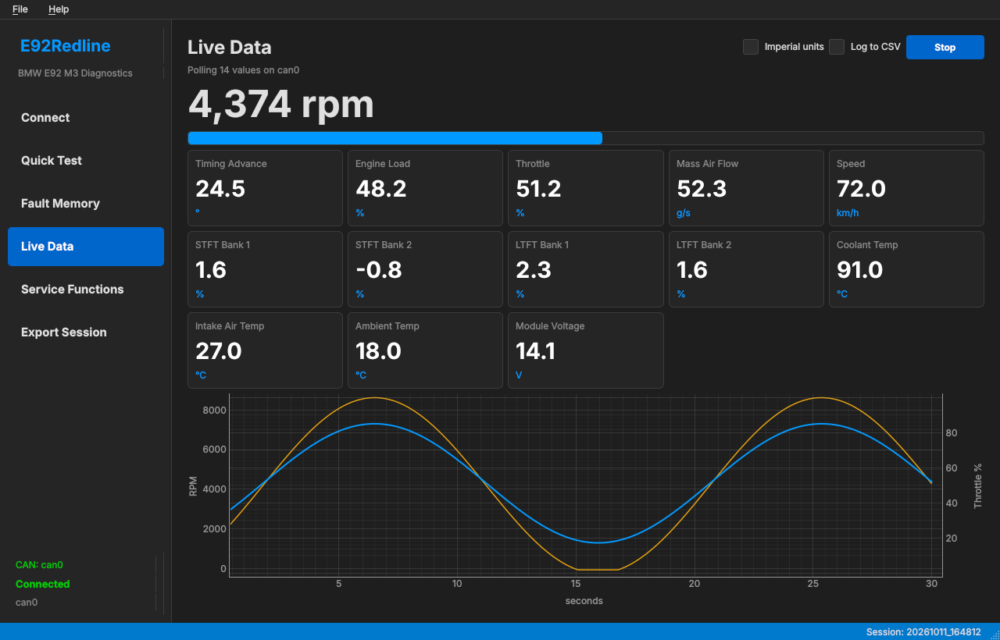

# E92Redline

A live data dashboard and diagnostic GUI tool for the BMW E92 M3 (S65) using SocketCAN on Linux. Watch RPM, timing, fuel trims, temperatures and more in real time, alongside ISTA-style guided workflows for fault codes and service functions.




## Features

- **Live Data Dashboard**: Real-time RPM with a redline bar, 13 more engine values as tiles, and a scrolling 30-second plot of RPM and throttle
- **Metric / Imperial Toggle**: Switch between °C, km/h, g/s and °F, mph, lb/min; your choice is remembered between launches
- **CSV Logging**: Record a drive to a CSV file for review afterward
- **Built-in ECU Simulator**: Develop and test the dashboard without the car using a virtual CAN bus
- **ISTA-Style Guided Workflows**: Step-by-step wizards for diagnostics
- **Quick Test (Module Scan)**: Discover and probe all ECU modules
- **Fault Memory Management**: Read, display, search, and clear DTCs
- **Service Functions**: Battery registration, ECU reset
- **Session Export**: Export diagnostic sessions as ZIP/JSON
- **Vehicle Info Display**: Shows VIN, series, and engine info when connected

## What This Tool Does NOT Do

**HARD BLOCKED - These features are explicitly prohibited:**

- Immobilizer/key programming
- Security bypass mechanisms
- VIN tampering or modification
- Odometer/mileage changes
- ECU flashing, tuning, or coding that can brick modules
- Any theft-adjacent workflows

These restrictions are enforced at multiple layers and cannot be circumvented. All blocked attempts are logged.

## Hardware Requirements

### Required Hardware

| Item | Description | Approx. Cost |
|------|-------------|--------------|
| **Innomaker USB2CAN** | USB to CAN adapter (SocketCAN compatible) | ~$33 |
| **DB9 to OBD2 Cable** | Connects USB2CAN to vehicle's OBD2 port | ~$18 |

**Total: ~$51**

### Where to Buy

Search Amazon for:
- `Innomaker USB2CAN` - Get the basic USB2CAN version ($32.99)
- `Innomaker DB9 to OBD2 cable` - The one that says "fits USB to CAN Module of Innomaker" ($17.99)

### What NOT to Buy

- **K+DCAN cables** - These don't work reliably on Linux (serial-based, not SocketCAN)
- **ELM327 adapters** - Wrong protocol entirely
- **USB to RS485 adapters** - Different protocol, won't work

### System Requirements

- **Linux**: Ubuntu 22.04+, Fedora 38+, Debian 12+, or any distro with SocketCAN support
- **Python 3.11+**
- **Kernel**: Linux 3.2+ (for gs_usb driver support)

## Installation

### From Source

```bash
# Clone the repository
git clone https://github.com/nuggetofwisdom/E92-Redline.git
cd E92-Redline

# Create virtual environment
python3.11 -m venv venv
source venv/bin/activate

# Install in development mode
pip install -e .
```

### Dependencies

Core dependencies are installed automatically:
- PyQt6 (GUI framework)
- python-can (CAN bus support)
- can-isotp (ISO-TP protocol)
- pyyaml (configuration and live data definitions)
- platformdirs (platform paths)
- pyqtgraph (live data plots)

## Hardware Setup

### 1. Connect the Hardware

```
[Laptop] --USB--> [Innomaker USB2CAN] --DB9 Cable--> [OBD2 Port on BMW]
```

### 2. Verify the Adapter is Detected

When you plug in the USB2CAN, it should be detected automatically:

```bash
# Check if the adapter is recognized
dmesg | tail -10

# You should see something like:
# usb 1-1: new full-speed USB device
# gs_usb 1-1:1.0: registered CAN device can0
```

### 3. Bring Up the CAN Interface

```bash
# Set up the CAN interface (500kbps for BMW)
sudo ip link set can0 up type can bitrate 500000

# Verify it's up
ip link show can0
```

### 4. (Optional) Auto-Setup on Boot

Create a systemd service or add to `/etc/network/interfaces`:

```bash
# /etc/network/interfaces.d/can0
auto can0
iface can0 can static
    bitrate 500000
```

Or create udev rule `/etc/udev/rules.d/99-can.rules`:

```
ACTION=="add", SUBSYSTEM=="net", KERNEL=="can*", RUN+="/sbin/ip link set %k up type can bitrate 500000"
```

## Usage

### Run the Application

```bash
# Make sure you're in the project directory with venv activated
source venv/bin/activate

# Run using module
python -m e92_redline

# Or using console script (after pip install)
e92-redline

# With debug logging
e92-redline --debug
```

### Command Line Options

```
usage: e92-redline [-h] [--debug] [--log-dir LOG_DIR] [--config CONFIG] [--version]

E92Redline - BMW E92 M3 Diagnostic Tool

options:
  -h, --help         show this help message and exit
  --debug, -d        Enable debug logging
  --log-dir LOG_DIR  Custom log directory (default: ./logs)
  --config CONFIG    Path to configuration file
  --version, -v      show program's version number and exit
```

## Workflow Guide

### 1. Connect to Vehicle

1. Connect USB2CAN to laptop
2. Connect DB9-to-OBD2 cable to USB2CAN and vehicle
3. Turn ignition ON (engine OFF recommended)
4. Set up CAN interface: `sudo ip link set can0 up type can bitrate 500000`
5. Launch E92Redline: `python -m e92_redline`
6. The app will detect `can0` - click "Connect"
7. Vehicle info (VIN, series, engine) will display in the sidebar

### 2. Quick Test (Module Scan)

1. Navigate to "Quick Test"
2. Click "Start Scan"
3. View the results showing all modules and their status:
   - **OK**: Module responding, no faults
   - **FAULT**: Module responding with DTCs
   - **NO RESPONSE**: Module not responding

### 3. Fault Memory

1. Navigate to "Fault Memory"
2. Click "Read DTCs" to retrieve all fault codes
3. Use filters to search and organize
4. Select DTCs to view details
5. Clear DTCs with confirmation dialogs

### 4. Live Data

1. Connect to the vehicle (see step 1). The engine can be running.
2. Navigate to "Live Data"
3. Optionally tick **Imperial units** and/or **Log to CSV**
4. Click "Start" to begin polling, and "Stop" when finished

The page polls standard OBD-II values from the engine computer, each at its own rate:

| Value | Rate | Value | Rate |
|-------|------|-------|------|
| Engine RPM | 10 Hz | Short-term fuel trim (banks 1 & 2) | 2 Hz |
| Timing advance | 5 Hz | Long-term fuel trim (banks 1 & 2) | 0.5 Hz |
| Engine load | 5 Hz | Coolant temperature | 1 Hz |
| Throttle position | 5 Hz | Intake air temperature | 1 Hz |
| Mass air flow | 5 Hz | Ambient air temperature | 0.2 Hz |
| Vehicle speed | 5 Hz | Module voltage | 1 Hz |

The RPM bar turns amber above 7,500 rpm. If a tile stays at `--`, the car isn't answering that value over OBD-II (see Troubleshooting).

### 5. Service Functions

**Battery Registration:**
1. Navigate to "Service Functions"
2. Select "Battery Registration"
3. Enter battery capacity and type
4. Confirm all preconditions
5. Execute the registration

**ECU Reset:**
1. Select "ECU Reset"
2. Choose the target module
3. Select reset type (Soft/Key Off-On)
4. Confirm and execute

### 6. Export Session

1. Navigate to "Export Session"
2. Select what to include
3. Export as ZIP or JSON
4. Share with technicians or for records

## Troubleshooting

### A Live Data tile stays at "--"

The engine computer doesn't report that value over standard OBD-II. The rest of the page keeps working; the poller simply skips values that get no reply. Some S65-specific data (such as per-cylinder misfire counts) is only available through BMW's own diagnostic identifiers and isn't supported yet.

### "No CAN interfaces detected"

1. Check if adapter is plugged in: `lsusb | grep -i can`
2. Check kernel messages: `dmesg | tail -20`
3. Make sure interface is up: `ip link show can0`
4. Bring it up if needed: `sudo ip link set can0 up type can bitrate 500000`

### "Failed to open CAN interface"

1. Check permissions - you may need sudo or udev rules
2. Verify bitrate is correct (500000 for BMW)
3. Check if another program is using the interface

### "CAN bus validation failed"

1. Check physical connection to vehicle
2. Ensure ignition is ON
3. Verify OBD2 cable is fully seated
4. Try disconnecting and reconnecting

### Interface shows but no communication

1. Verify you have the correct cable (CAN, not K-line)
2. Check that vehicle ignition is ON
3. Some modules need engine running

## Configuration

Configuration is stored in `~/.config/e92_redline/config.yaml`:

```yaml
datapacks_dir: ~/.config/e92_redline/datapacks
connection:
  timeout: 1.0
ui:
  theme: dark
  confirm_dtc_clear: true
logging:
  log_level: INFO
  log_dir: ./logs
```

## Adding Live Data Values

Live values are defined in `src/e92_redline/live_data/pids.yaml`. Each entry is a standard OBD-II Mode 01 PID with a formula over its raw data bytes `A`, `B`, ...:

```yaml
- {id: coolant, name: Coolant Temp, pid: 0x05, bytes: 1, formula: "A - 40", unit: "°C", hz: 1}
```

- `unit` is always metric; the page converts °C, km/h and g/s for imperial display
- `hz` is how often the value is polled. Total throughput is roughly 15–30 requests per second, so keep slow-changing values at low rates
- A new entry gets a tile automatically

## Datapacks

Additional module definitions can be loaded from user datapacks.

Place datapack files in `~/.config/e92_redline/datapacks/`.

## Development

### Running Tests

```bash
# Install dev dependencies
pip install -e ".[dev]"

# Run tests
pytest

# Run with coverage
pytest --cov=e92_redline --cov-report=html
```

### Testing Without a Car

`tools/fake_ecu.py` simulates the engine computer on a virtual CAN bus, answering every Live Data request with a sweeping RPM and plausible values.

```bash
# One-time per boot: create the virtual CAN interface
sudo modprobe vcan
sudo ip link add dev vcan0 type vcan
sudo ip link set vcan0 up

# Terminal 1: start the simulated ECU
python tools/fake_ecu.py

# Terminal 2: run the app, connect to vcan0, open Live Data, click Start
e92-redline
```

Install `can-utils` and run `candump vcan0` to watch the raw requests and replies.

### Code Quality

```bash
# Format code
black src tests

# Lint
ruff check src tests

# Type checking
mypy src
```

## Logging

All diagnostic actions are logged to `./logs/` in JSONL format for audit purposes:

```json
{"timestamp": "2024-01-15T10:30:00", "level": "INFO", "action": "clear_dtc", "module_id": "DME", "success": true}
```

When **Log to CSV** is ticked, Live Data is recorded to `./logs/live_YYYYMMDD_HHMMSS.csv`, one row per reading. Values are always stored in metric units, regardless of the display toggle:

```csv
seconds,value_id,value
0.012,rpm,812.500
0.118,timing,12.000
```

## Safety and Security

This tool is designed with safety as a priority:

1. **Safety Manager**: All operations are checked against blocked lists
2. **Two-Step Confirmations**: Destructive actions require confirmation
3. **Audit Logging**: Every action is logged with timestamps
4. **No Security Bypass**: Security Access service is blocked
5. **No ECU Flashing**: Upload/Download services are blocked

## Contributing

Contributions are welcome! Please ensure:

1. All tests pass
2. Code is formatted with black
3. No security-sensitive features are added
4. Safety blocks are not circumvented

## License

MIT License - See [LICENSE](LICENSE) for details.

## Disclaimer

This software is provided as-is for educational and diagnostic purposes. Users are responsible for ensuring proper use. The authors are not liable for any damage resulting from use of this software.

Always follow proper diagnostic procedures and safety precautions when working with vehicle electronics.
